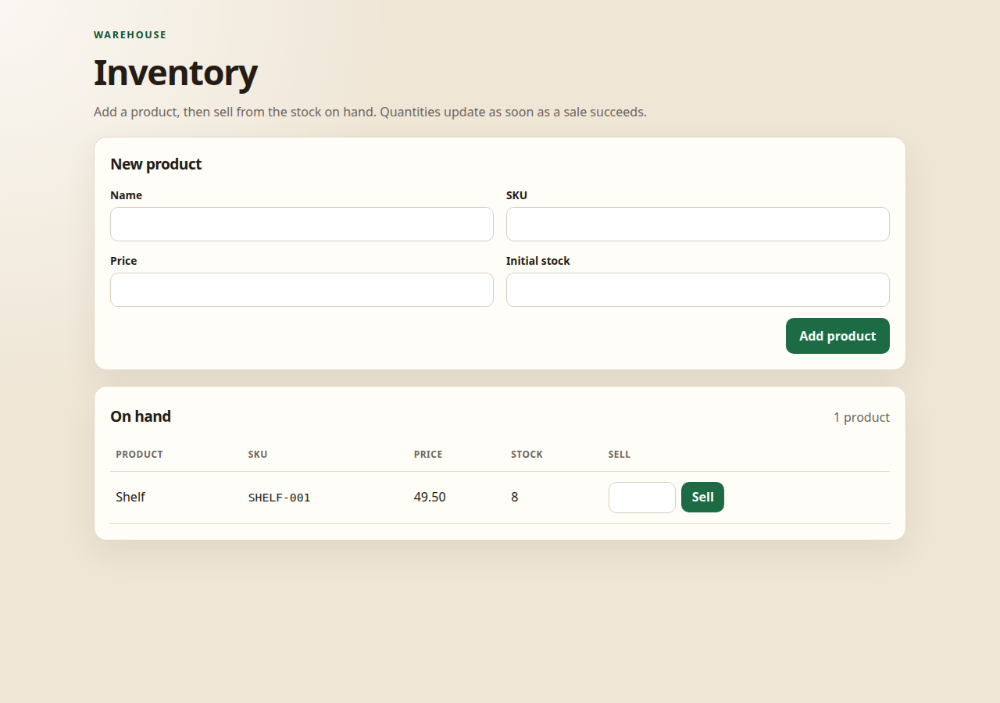

# Inventory & Stock Management

A Laravel application for keeping product inventory and recording sales without letting stock fall below zero. Staff can add a product, page through what is on hand, and sell a quantity. The stock figure on the page updates as soon as the sale succeeds.

## Features

- Create a product with a name, a unique SKU, a non-negative price, and a non-negative starting stock.
- List products with `page` and `limit` query parameters.
- Sell a positive whole-number quantity of a product.
- Reject a sale when the quantity is missing, zero, negative, or greater than the available stock.
- Deduct stock with one conditional database update so overlapping sales cannot oversell.
- Browser page for creating products, reviewing inventory, selling stock, and showing validation and API errors without a full page reload.

## Technology stack

- PHP 8.3 or newer
- Laravel 13
- MySQL 8 (or MariaDB) for the application database
- SQLite in memory for the automated test suite
- Vanilla JavaScript and the Fetch API
- PHPUnit 12

## Architecture

HTTP stays in the controller. Validation lives in form requests. Stock rules live in one service. JSON shape lives in one API resource.

```text
app/
  Exceptions/InsufficientStockException.php   409 when a sale does not fit
  Http/Controllers/ProductController.php      thin HTTP adapter
  Http/Requests/                              create, list, and sell validation
  Http/Resources/ProductResource.php          product JSON
  Models/Product.php                          fillable attributes and casts
  Services/ProductService.php                 create, paginate, atomic sale
database/migrations/                          products table
public/js/inventory.js                        page behavior
public/css/inventory.css                      page layout
resources/views/inventory.blade.php           inventory screen
routes/api.php                                /api/products routes
routes/web.php                                inventory page
tests/Feature/                                API and page tests
```

A product response always uses the same object:

```json
{
  "data": {
    "id": 1,
    "name": "Shelf",
    "sku": "SHELF-001",
    "price": "49.50",
    "stock": 12,
    "created_at": "2026-11-23T08:43:24.000000Z"
  }
}
```

Lists add Laravel pagination under `meta`. Errors use `message`, and validation errors also include `errors`.

## Prerequisites

- PHP 8.3+ with the `pdo_mysql` and `pdo_sqlite` extensions
- Composer 2
- MySQL 8 or MariaDB
- A terminal

The inventory page does not need a Node.js build.

## Installation

```bash
git clone https://github.com/srimoy-stack/Inventory-app.git
cd Inventory-app
composer install
cp .env.example .env
php artisan key:generate
```

## MySQL database and environment

Create the database:

```sql
CREATE DATABASE inventory CHARACTER SET utf8mb4 COLLATE utf8mb4_unicode_ci;
```

`.env.example` is already set for this database. Put the real password only in `.env`, which is not committed:

```dotenv
DB_CONNECTION=mysql
DB_HOST=127.0.0.1
DB_PORT=3306
DB_DATABASE=inventory
DB_USERNAME=root
DB_PASSWORD=your_password
```

Then migrate and start the application:

```bash
php artisan migrate
php artisan serve
```

Open [http://127.0.0.1:8000](http://127.0.0.1:8000).

## Screenshots

The home page lists products that are already in stock and keeps a form for adding another.



## Demo

1. Open the home page.
2. Add a product, for example name `Shelf`, SKU `SHELF-001`, price `49.50`, stock `12`.
3. Confirm the row appears in the table without reloading the page.
4. Enter `4` in that row's quantity field and choose **Sell**. The stock cell becomes `8`.
5. Enter a quantity larger than the stock and choose **Sell**. The page shows `Insufficient stock.` and the stock cell does not change.
6. Submit the form again with the same SKU. The page shows that the SKU has already been taken.

## API

The API prefix is `/api`. Send `Accept: application/json` and `Content-Type: application/json`.

### Create a product

`POST /api/products`

```bash
curl -X POST http://127.0.0.1:8000/api/products \
  -H 'Accept: application/json' \
  -H 'Content-Type: application/json' \
  -d '{"name":"Shelf","sku":"SHELF-001","price":49.50,"stock":12}'
```

`201 Created`

```json
{
  "data": {
    "id": 1,
    "name": "Shelf",
    "sku": "SHELF-001",
    "price": "49.50",
    "stock": 12,
    "created_at": "2026-11-23T08:43:24.000000Z"
  }
}
```

Validation rules:

| Field | Rules |
|---|---|
| `name` | Required string, at most 255 characters |
| `sku` | Required string, at most 255 characters, unique |
| `price` | Required number, at least 0, at most 2 decimal places, at most `99999999.99` |
| `stock` | Required integer, at least 0 |

`422 Unprocessable Entity` when validation fails:

```json
{
  "message": "The sku has already been taken.",
  "errors": {
    "sku": ["The sku has already been taken."]
  }
}
```

Price `0` and stock `0` are valid.

### List products

`GET /api/products?page=1&limit=15`

`page` defaults to `1`. `limit` defaults to `15` and cannot be greater than `100`.

```bash
curl 'http://127.0.0.1:8000/api/products?page=1&limit=15' \
  -H 'Accept: application/json'
```

`200 OK`

```json
{
  "data": [
    {
      "id": 1,
      "name": "Shelf",
      "sku": "SHELF-001",
      "price": "49.50",
      "stock": 12,
      "created_at": "2026-11-23T08:43:24.000000Z"
    }
  ],
  "links": {
    "first": "http://127.0.0.1:8000/api/products?page=1",
    "last": "http://127.0.0.1:8000/api/products?page=1",
    "prev": null,
    "next": null
  },
  "meta": {
    "current_page": 1,
    "last_page": 1,
    "per_page": 15,
    "total": 1
  }
}
```

`page` below 1, or `limit` outside 1–100, returns `422`.

### Sell stock

`POST /api/products/{id}/sell`

```bash
curl -X POST http://127.0.0.1:8000/api/products/1/sell \
  -H 'Accept: application/json' \
  -H 'Content-Type: application/json' \
  -d '{"quantity":4}'
```

`200 OK`

```json
{
  "data": {
    "id": 1,
    "name": "Shelf",
    "sku": "SHELF-001",
    "price": "49.50",
    "stock": 8,
    "created_at": "2026-11-23T08:43:24.000000Z"
  }
}
```

| Situation | Status | Body |
|---|---|---|
| Quantity missing, `0`, negative, or not an integer | `422` | Validation `errors.quantity` |
| Quantity greater than the current stock | `409` | `{ "message": "Insufficient stock." }` |
| Unknown product id | `404` | `{ "message": "Product not found." }` |

## Atomic stock deduction

`ProductService::sell()` runs this update inside a database transaction:

```sql
UPDATE products
SET stock = stock - :quantity
WHERE id = :id
  AND stock >= :quantity
```

The database applies the subtraction only while the row still has enough stock. If two requests sell the last units at the same time, one update changes the row and the other matches zero rows. The loser returns `409` and the stored stock never becomes negative. The availability check is the `WHERE` clause of the same statement that writes the new stock, so the decision and the write cannot be separated.

On MySQL and MariaDB the migration also adds `CHECK (price >= 0)` and `CHECK (stock >= 0)`. `stock` is an unsigned integer. `sku` has a unique index.

## Testing

The test suite uses SQLite in memory, configured in `phpunit.xml`. It does not need the MySQL database.

```bash
php artisan test
```

Covered cases include creating a product, rejecting a duplicate SKU and invalid price or stock, pagination, a successful sale, selling the final unit, insufficient stock, a second sale that would oversell, a missing product, and the inventory page markup.

## Remaining limitations

- The API is not authenticated. That matches this assessment's scope.
- The MySQL check constraints are applied only when the connection is MySQL or MariaDB. SQLite, which the test suite uses, relies on validation and the conditional stock update.
- The page checks empty fields and a non-positive sell quantity before calling the API. The API still enforces those rules.
